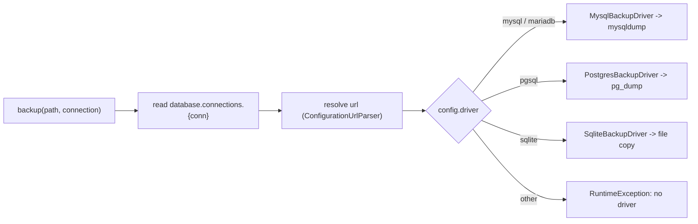

# Backup & restore

`Backup\BackupManager` (bound to `Backup\Contracts\BackupManagerInterface`)
coordinates database backups using a driver pattern, and restores from `.sql`
files via `Backup\SqlFileRestorer`.

```php
use Simtabi\Laranail\DbTools\Backup\Contracts\BackupManagerInterface;

$manager = app(BackupManagerInterface::class);
// or: Simtabi\Laranail\DbTools\DbTools::backup(...)
```

## How drivers are resolved

On construction `BackupManager` registers the three default drivers
(`MysqlBackupDriver`, `PostgresBackupDriver`, `SqliteBackupDriver`). When you
call `backup()`, the manager reads the connection's config, resolves its `url`
the way Laravel does before opening PDO (see
[Connection URLs](#connection-urls-and-managed-databases)), takes the resulting
`driver` value, and asks each registered driver `supports($driver)` until one
matches. If none match it throws a `RuntimeException`.



`supportsDriver(string $driver)` reports whether any registered driver matches a
driver name without performing a backup:

```php
$manager->supportsDriver('pgsql'); // true
$manager->supportsDriver('oracle'); // false
```

## Creating a backup

```php
$manager->backup(storage_path('backups/dump.sql'));            // default connection
$manager->backup(storage_path('backups/pg.dump'), 'pgsql');    // named connection
```

### MySQL / MariaDB

Shells out to `mysqldump`. The password goes into a temporary option file with
mode `0600`, passed as `--defaults-extra-file` and deleted as soon as the client
exits — never on the command line, and no longer through the deprecated
`MYSQL_PWD` variable. The connection config must contain `host`, `username`,
`password`, and `database` (directly or through `url`); `port` (default `3306`)
and a socket are optional. The socket is Laravel's `unix_socket` (or `socket`);
with one set the client connects through it (`--protocol=SOCKET`) and ignores
host and port, exactly as PDO does. Writes via `--result-file`.

Every dump runs with:

| Flag | Why |
|---|---|
| `--single-transaction` | A consistent InnoDB snapshot without `LOCK TABLES`. |
| `--no-tablespaces` | Tablespace statements need `PROCESS`, which managed users lack. |
| `--triggers` | Triggers come with the schema. |
| `--routines --events` | Only with `backup.mysql.routines => true`. A binlogged managed server refuses a stored function from a non-`SUPER` user (error 1418) unless `log_bin_trust_function_creators` is on, so they are opt-in, as in `mysqldump` itself. |
| `--set-gtid-purged=OFF` | Only when the client's `--help` lists it (MySQL's does, MariaDB's does not). A GTID server otherwise writes `SET @@GLOBAL.GTID_PURGED`, which needs `SUPER` to replay. |

### PostgreSQL

Shells out to `pg_dump` with `--format=custom --no-password`. The archive keeps
owners and grants, so a restore with any other tool keeps them too; this
driver's restore leaves them out instead (see [Restoring](#restoring)). The
password is passed via the `PGPASSWORD` environment variable. Requires `host`,
`username`, `password`, `database` (directly or through `url`); `port` (default
`5432`) and `schema` are optional. Writes via `--file`.

Before `pg_dump` runs, the driver compares its major version (`--version`) with
the server's (`SHOW server_version_num`, through `psql`, bounded to 30 seconds
with `PGCONNECT_TIMEOUT=10`) and throws when the client is older: `pg_dump` 15
cannot dump a PostgreSQL 18 server. The message names both versions and the
`backup.binaries.pg_dump` key to point at a newer client. If either version
cannot be read, the check steps aside and `pg_dump` reports what stopped it.

`pg_restore` is not held to the server's version: it reads any archive an equal
or older `pg_dump` wrote, into any server. An archive from a newer `pg_dump`
fails with a message saying so and naming `backup.binaries.pg_restore`.

## Connection URLs and managed databases

A managed provider (DigitalOcean, RDS, Aiven, …) hands out one connection URL
and requires TLS. The backup drivers read the connection the way the application
does:

- **`url` wins.** The config passes through Laravel's `ConfigurationUrlParser`,
  so `url` overrides `host`, `port`, `database`, `username` and `password`, its
  scheme picks the driver, and query parameters (`?sslmode=require`,
  `?ssl-mode=REQUIRED`) become config keys.
- **MySQL TLS** comes from the same PDO options the application connects with:

  | Source | Client flag |
  |---|---|
  | `Pdo\Mysql::ATTR_SSL_CA` (or `ssl-ca`) | `--ssl-ca` |
  | `Pdo\Mysql::ATTR_SSL_CAPATH` | `--ssl-capath` |
  | `Pdo\Mysql::ATTR_SSL_CERT` | `--ssl-cert` |
  | `Pdo\Mysql::ATTR_SSL_KEY` | `--ssl-key` |
  | `Pdo\Mysql::ATTR_SSL_CIPHER` | `--ssl-cipher` |
  | `ssl-mode` / `sslmode` | `--ssl-mode` |

  Without an explicit mode, a CA means `--ssl-mode=VERIFY_IDENTITY`, as mysqlnd
  verifies by default; `ATTR_SSL_VERIFY_SERVER_CERT => false` means `REQUIRED`
  without the CA. libpq spellings (`require`, `verify-full`, …) are accepted, and
  an unrecognised mode throws rather than falling back to plaintext. `REQUIRED`
  never passes the CA, because the MySQL client would verify against it. MariaDB's
  client, which has no `--ssl-mode`, gets `--ssl --ssl-verify-server-cert`, or
  `--ssl --skip-ssl-verify-server-cert` for `REQUIRED` (MariaDB 11.4+ verifies by
  default). Which client is installed is read from its `--help`; when that cannot
  run, the backup fails with the reason rather than guessing.
- **PostgreSQL TLS** goes to libpq through the environment: `sslmode`,
  `sslrootcert`, `sslcert` and `sslkey` become `PGSSLMODE`, `PGSSLROOTCERT`,
  `PGSSLCERT` and `PGSSLKEY` — the same keys Laravel puts in the PDO DSN.
- **PostgreSQL `hostaddr`** becomes `PGHOSTADDR`: libpq dials that address and
  still verifies the certificate against `host`. It can be a key of its own, or
  follow the name in `host` as `db.example.com;hostaddr=127.0.0.1`, the form
  PDO accepts and laranail/db-console writes for a server behind an SSH tunnel.

```php
// config/database.php — DB_URL=postgresql://doadmin:…@db-….ondigitalocean.com:25060/defaultdb?sslmode=require
'pgsql' => [
    'driver'      => 'pgsql',
    'url'         => env('DB_URL'),
    'sslrootcert' => env('DB_SSLROOTCERT'), // the provider's CA certificate
    // …
],
```

> A provider's own scheduled backups and point-in-time recovery are the primary
> backup on a managed cluster. A dump from here is a portable copy, not a
> replacement for them.

### gzip, excluded tables, and binary paths

The MySQL and PostgreSQL drivers honour the
[`db-tools.backup`](../configuration.md#backup) config:

- `backup.gzip` — when `true`, the dump is gzip-compressed and the driver
  appends `.gz` to the path.
- `backup.exclude` — table names omitted from the dump.
- `backup.binaries.*` — absolute paths to the CLI tools (`mysqldump`, `mysql`,
  `pg_dump`, `pg_restore`, `psql`) when they are not on `PATH`; `null` means
  "rely on `PATH`".
- `backup.mysql.routines` (default `false`) — also dump stored routines and
  events.
- `backup.mysql.strip_definers` (default `true`) — remove `DEFINER=` clauses on
  restore so a non-`SUPER` user can replay views and triggers; the objects then
  run as the restoring user. Set `false` on a self-hosted server whose
  `SQL SECURITY DEFINER` objects must keep their definer.
- `backup.timeout` (env `DB_TOOLS_BACKUP_TIMEOUT`, default `3600`) — seconds a
  dump or restore may run before it is killed; `0` removes the limit. Laravel's
  own process default is 60 seconds, which no production-sized dump fits in.

### SQLite

Copies the database file to the backup path (creating the target directory if
needed) and, when present, copies the `-wal` and `-shm` sidecar files too.
Requires the `database` config path. Backing up a `:memory:` database throws a
`RuntimeException`.

## Restoring

```php
$manager->restore(storage_path('backups/dump.sql'));
$manager->restore(storage_path('backups/pg.dump'), 'pgsql');
```

`restore()` is **driver-aware**: it resolves the connection's driver and
delegates to that driver, so the restore mechanism matches the dump format.

- **PostgreSQL custom-format dumps** restore through `pg_restore` (not the
  SQL-text path) with `--clean --if-exists --no-owner --no-privileges
  --single-transaction --exit-on-error`: objects belong to the restoring user, and
  a failure rolls the whole restore back.
- **MySQL** streams the dump through the `mysql` client line by line, so a large
  dump is never held in memory, and (unless `backup.mysql.strip_definers` is
  `false`) strips `DEFINER=user@host` clauses on the
  way: only `SUPER` may create an object owned by another account (error 1227 on
  a managed server). `INSERT` lines are passed through untouched, so row data
  that happens to contain the text is never rewritten.
- **PostgreSQL plain `.sql` dumps** replay through `psql` with
  `--set=ON_ERROR_STOP=1`, so the first failing statement stops the restore and
  it reports failure. Without it psql carries on and exits 0.
- **SQLite** uses `SqlFileRestorer` for a plain `.sql` file, or a file copy
  otherwise.

For plain `.sql` text, `SqlFileRestorer`:

1. Validates the file exists, is readable, and is non-empty (else
   `InvalidArgumentException`).
2. Strips single-line (`-- …`) and block (`/* … */`) comments, then splits the
   SQL into statements on `;`, respecting quoted string literals and escaped
   quotes.
3. Executes every statement inside a single transaction (via the
   `ManagesTransactions` trait). A failing statement rolls back the whole
   restore and surfaces a `RuntimeException`.

Gzipped dumps and the optional `pg_restore` / `mysql` / `psql` binary paths from
[`db-tools.backup`](../configuration.md#backup) are honoured on restore
too.

## Importing a dump file

`Files\DatabaseFileService::handleImport()` is a thin entry point for importing
a backup file. It checks the extension, resolves the real path, confines it to
the configured import directory, then delegates to the driver-aware `restore()`
above — no shell calls happen in the service itself.

The import directory comes from
[`db-tools.files.import_base`](../configuration.md), which defaults to
`storage_path('app')`. Set it to `null` to allow imports from anywhere.

> Before 0.6.0 the docblock claimed path-traversal protection but only called
> `realpath()`, which **canonicalises** a path rather than rejecting it — so any
> readable `.sql` anywhere on the filesystem was importable.

```php
use Simtabi\Laranail\DbTools\Files\Contracts\DatabaseFileServiceInterface;

app(DatabaseFileServiceInterface::class)
    ->handleImport(storage_path('backups/dump.sql'));        // default connection
    // ->handleImport($path, 'pgsql');                       // named connection
```

Only `.sql` and `.dump` files are importable. A live SQLite database file
(`.sqlite` / `.db`) is intentionally refused — importing it would mean swapping
the running database file in place, which is out of scope for a dump import;
`handleImport()` throws a `RuntimeException` for those.

## Preflight: will a backup run?

`BackupManager::preflight(?string $connection = null)` says whether a backup of
the connection could run now, without dumping anything. It returns a
`BackupPreflight`, or `null` when the connection's driver cannot preflight:

| Field | Meaning |
|---|---|
| `status` | `PreflightStatus::Ready`, `Missing` (the tool will not run) or `Outdated` (the tool is older than the server) |
| `tool`, `binary` | the tool the backup runs (`pg_dump`, `mysqldump`) and the path or name it would run |
| `clientVersion`, `serverVersion` | major versions, `null` where they could not be read |
| `message` | what was found, and the fix |

```php
$preflight = app(BackupManager::class)->preflight('pgsql');

if (! $preflight?->isReady()) {
    logger()->warning($preflight->message);
}
```

Each driver checks what can stop its own dump:

- **PostgreSQL**: `pg_dump` runs, and its major is at least the server's.
  `pg_dump` cannot dump a newer server, so `backup()` refuses that client
  up front with the same message. A server whose version cannot be read is not
  compared.
- **MySQL / MariaDB**: `mysqldump` runs. It dumps servers newer than itself, so
  no version is compared.
- **SQLite**: always ready; the backup copies the file.

A dump client is easy to have and still miss: a host whose `PATH` lacks it, or
an old client earlier on `PATH` than a new one. A process keeps the `PATH` it
started with, so a shell, worker or IDE started before the fix still runs the
old one. Run the preflight from the process that will take the backups.

## Custom drivers

`registerDriver()` appends a driver implementing `BackupDriverInterface`
(`backup(array $config, string $path): bool` + `supports(string $driver): bool`)
and returns `$this`, so you can register additional or override database
support. A driver that also implements `BackupDriverPreflightInterface`
(`preflight(array $config): BackupPreflight`) takes part in the preflight;
one that does not makes `preflight()` return `null`.

```php
$manager->registerDriver(new MyCustomBackupDriver());
```

## Reference

```php
// BackupManagerInterface
public function backup(string $path, ?string $connection = null): bool;
public function restore(string $path, ?string $connection = null): bool;
public function supportsDriver(string $driver): bool;

// BackupManager (concrete), also BackupManagerPreflightInterface
public function registerDriver(BackupDriverInterface $driver): static;
public function preflight(?string $connection = null): ?BackupPreflight;

// BackupDriverInterface
public function backup(array $config, string $path): bool;
public function supports(string $driver): bool;

// BackupDriverPreflightInterface (optional, per driver)
public function preflight(array $config): BackupPreflight;
```

---
[← Docs index](../../README.md#documentation)
